# RQ-03F-B3-C3 — Monotonic Trust Ledger, Anti-Rollback & Recovery Foundation

## Delivery status

- Starting trusted master: `b894077fb5967a9aed8713892f448acfa5b65b62`.
- Starting C2 post-merge run [38114284561](https://github.com/ArdenZC/codex-work-skills/actions/runs/38114284561): `SUCCESS` at the starting master SHA.
- C1 Hosted [38112567308](https://github.com/ArdenZC/codex-work-skills/actions/runs/38112567308), C2 Hosted [38112567301](https://github.com/ArdenZC/codex-work-skills/actions/runs/38112567301), and Template Package [38112567310](https://github.com/ArdenZC/codex-work-skills/actions/runs/38112567310): `SUCCESS` at C2 PR head `b32e9c53f183e1a1ec5e4137411e53f1e9be4840`.
- Formal Trust Anchor: `eb4a95c618e05c5ad6413137478bc65dbca75ec9` (not changed or written).
- Branch: `feature/rq03f-b3c3-monotonic-trust-ledger`.
- Draft PR: [#62](https://github.com/ArdenZC/codex-work-skills/pull/62), current implementation HEAD `8ef89b6e65897193f71a7da5a113002249679e96`.
- Formal Production Operator Trust, external High-Water Authority, protected Intake, Agent A/B, Live Qualification, RC-02, and Lesson Skill 2.4 remain blocked/not started.

## Scope and threat model

C3 addresses rollback or split-brain of the Operator's local Profile/Index/Ledger projection after filesystem restore, stale process state, concurrent writers, partial persistence, or a lost commit response. Candidate-controlled JSON, hashes, paths, Python import paths, and local locks are not trust roots. The local ledger detects local inconsistency but cannot detect a complete rollback of its own storage domain.

The protocol therefore separates the Operator-owned projection from a `HighWaterAuthority` contract. A future Authority must be separately provisioned and authenticated, enforce linearizable compare-and-swap (CAS) with fencing, and retain a durable non-rollback history outside the Operator snapshot/backup domain. C3 deliberately includes no production Authority adapter, key, endpoint, or Owner approval credential. The hosted Witness is synthetic, branch-controlled code on the same temporary GitHub runner; it demonstrates the protocol and Linux UID boundary only.

## Versioned contracts

Four new closed JSON Schemas reject unknown properties:

| Contract | Version | Purpose |
| --- | --- | --- |
| `rq03f-monotonic-trust-ledger-v1.0.schema.json` | Ledger 1.0 | Complete ordered local projection of committed Authority history. |
| `rq03f-monotonic-trust-ledger-record-v1.0.schema.json` | Ledger Record 1.0 | One sequence-bound committed state and its previous-state/record links. |
| `rq03f-trust-transition-v1.0.schema.json` | Transition 1.0 | Closed transition request and lifecycle status contract. |
| `rq03f-high-water-authority-response-v1.0.schema.json` | Authority Response 1.0 | Typed current snapshot, freshness, fencing token, and pending IDs. |

Every committed state binds policy identity and epoch, Profile SHA-256, Build Inventory SHA-256, Controller and Generation IDs, Index 1.1 SHA-256 and revision, revocation-state SHA-256, and revoked authority/role references. Every Ledger record binds its Authority identity, contiguous sequence, previous committed state digest, previous record SHA-256, current state digest, transition ID, purpose, committed status, approval reference, and UTC audit timestamp. Genesis is sequence zero with no previous digests. Timestamps are audit metadata; monotonicity is the Authority sequence and CAS state.

The C3 module strictly parses duplicate-free JSON, verifies closed schemas, exact history length and order, both record chains, and the snapshot head against the complete Authority history. It refuses an unavailable Authority, stale response, identity mismatch, pending transition, local recovery marker, missing/truncated/reordered history, old Index, same-revision/different-SHA state, and mixed Profile/Index/Generation bindings.

## State validation

- Epoch cannot decrease or skip. An epoch change requires Authority-verified `owner_policy_transition` authorization bound to the exact transition and proposed-state digest, a different approver from actor, a new Profile SHA, and a new Generation ID.
- Policy identity, Profile, Build Inventory, Controller, Generation, and revocation digest are fixed within one epoch. A Profile/role/revocation change therefore requires the next Owner-approved epoch under this contract.
- Revoked authority IDs and role authorization references are monotonic sets; an old revocation cannot disappear from history. `revocation_state(profile)` hashes role identity, authorization reference, allowed roles, validity window, revocation time/reason, and revoked authority IDs.
- Index 1.1 transitions must have exact old-array prefixes, continuous revision, matching byte hashes, correct epoch/Controller, and unique operation/receipt/authoring/run/intake IDs. Same-epoch changes must append a row; a policy-epoch transition may change the Index epoch without fabricating a record.
- Gate results are exact `GateResult` objects, never booleans or Candidate JSON. They bind authority identity, policy, epoch, Profile, Build, Controller, Generation, Index revision/SHA, revocation digest, operation purpose, freshness, and fencing token. Each sensitive C2 request constructs a fresh request and rechecks the Authority; Gate results are not cached.

## Commit protocol and linearization point

`MonotonicTransitionCoordinator.commit()` follows this order:

1. Read and validate the current Authority snapshot and complete local Ledger projection; reject recovery markers or pending transitions.
2. Compare the exact local Index bytes to the Authority state and validate the proposal, independent authorization, epoch/revocation successor, and append-only Index.
3. Ask the Authority to reserve the transition against the current sequence/state digest. The Authority returns a unique typed fencing token.
4. Exclusively stage and fsync the exact candidate Index bytes in the Operator projection; reread and compare the staged bytes.
5. Ask the Authority to perform the conditional commit. **The Authority's successful CAS is the linearization point.** This is the only point at which the proposed state becomes committed.
6. Install the staged Index, then project the Authority's complete committed Ledger history locally, with file and parent-directory durability checks.
7. Reread the Authority and independently verify the latest snapshot, Index SHA, Ledger chain, sequence, and absence of pending transitions before returning success.

An ordinary `rename()` never claims to make the two trust domains atomic. Before the Authority commit, an abort is permitted only if the old committed Index still matches the Authority. After the commit, any uncertain local state receives a recovery marker and returns `RECOVERY_REQUIRED`. A local marker blocks the Gate. Recovery may install only the exact staged bytes whose SHA matches the latest Authority commit; missing, divergent, or ambiguous bytes stay blocked. It never resets the ledger, restores an old index, lowers an epoch, or reuses a committed ID.

```mermaid
stateDiagram-v2
    [*] --> Prepared: Authority CAS reservation
    Prepared --> Staged: exact candidate bytes fsynced
    Staged --> Committed: Authority conditional commit (linearization)
    Staged --> Aborted: Authority abort, old Index still verified
    Committed --> Projected: install Index and Ledger projection
    Projected --> Verified: independent reread succeeds
    Committed --> RecoveryRequired: ACK, fsync, or projection uncertain
    RecoveryRequired --> Projected: exact latest committed bytes verified
    RecoveryRequired --> [*]: unresolved or conflicting evidence; remain blocked
```

| Failure point | Required result |
| --- | --- |
| Before prepare | No committed state change; reject. |
| After prepare / before staging | Abort only while current Index still matches the old Authority state; otherwise mark recovery-required. |
| After staging / before Authority commit | Abort only against the unchanged old Index; the transition ID remains consumed. |
| Authority commit accepted but ACK lost | Mark recovery-required; query the Authority, reconcile the exact staged committed bytes, then permit idempotent retry of that same transition. |
| After Authority commit / before or after local Index replacement | Keep writes blocked and recover only from exact staged bytes and current Authority history. |
| Ledger projection fsync or final reread fails | Keep writes blocked; do not claim success until an independent reread verifies the projection. |
| Authority unavailable, sequence conflict, stale fencing token, or unknown status | Fail closed; unresolved status is not inferred as committed or aborted. |

Recovery runbook: stop all writers; obtain a fresh authenticated Authority snapshot and transition status; validate Authority identity and full chain; compare local committed and staged bytes; follow only the exact committed or still-prepared outcome returned by the Authority; fsync and reread all local projections; clear a marker only after independent final verification. If any step lacks an authoritative answer or exact bytes, preserve evidence and leave `RECOVERY_REQUIRED` for Owner-directed recovery.

## C2 integration and default deny

`operator_controller_bootstrap.py` adds the C3 module and all four C3 schemas to the trusted installed-code closure. The build inventory must therefore be rebuilt and independently reviewed/approved before any future installation can pin this closure. The provider constructs fresh C3 request bindings from its revalidated C2 Policy/Profile/Build/Index state and accepts only the pinned `MonotonicAntiRollbackGate` implementation and its complete typed result.

C2 `ReadOnlyPreflightTrustContext` and `require_protected_write()` remain unconditional. C3 verification does not grant a production role, write access, Intake capability, Teacher/PA/Generation authorization, or service activation. No environment switch or CLI argument enables writes. Tests explicitly pass a successful synthetic Gate to the C2 provider and verify that protected writes are still denied.

## Deterministic tests and local environment evidence

The new C3 module has 52 tests covering closed schemas and duplicate JSON, Ledger chain and Authority freshness, state/epoch/profile/Generation/revocation/Index mismatches, stale and replayed transitions, duplicate operation IDs, stale fencing/CAS, two writers racing one revision, definite CAS rejection after a competing commit, ABA restoration, C2 old-context behavior, and transaction/recovery failure injection before prepare, after prepare, after staging, after Authority commit, after Index install, after local Ledger projection, before final reread, and after lost ACK. Filesystem tests exercise exclusive staging, symlink/hardlink rejection, and exact atomic projection behavior.

Current local regression result: C3 + C2 + C1 deterministic modules passed **108 tests** (`C3 52`, `C2 31`, `C1 25`; one inherited C1 POSIX ACL test is intentionally skipped locally and runs in hosted Linux). The targeted C3 shard-manifest assertion also passed (109 tests in that combined command). `git diff --check` and Python compilation passed. The full `tests.test_run_test_shards` module has an existing Gradebook validator failure described below.

The Gradebook failure was reproduced on this branch and on an isolated clean worktree at the same trusted base `b894077fb5967a9aed8713892f448acfa5b65b62`; no Gradebook code, workbook asset, or Gradebook test is modified here. The base and branch both fail `test_gradebook_discovery_worker_does_not_reuse_lesson_package_common` because the nested `test_template_validator` returns 1 with `Named-range template changed protected workbook structure or formatting.` The Codex runtime resolves `soffice` to `/opt/codex/runtimes/codex-primary-runtime/dependencies/bin/override/soffice`, version `LibreOfficeDev 26.8.0.0.alpha0 2c87e51eeaa2b413ff4ae097b2705eea1995d8e5`. The validator reports 20 protected-signature differences; the observed difference is `font.charset` changing from `1` to `null` on LibreOfficeDev XLS round-trip (first reported at `non_target_sheets.Sheet1.cells[1][1].format.font`). This is a reproduced baseline/environment incompatibility, not reported as a pass. Fresh Template Package CI remains required to establish the hosted result.

## Hosted Linux evidence boundary

The new `rq03f-b3c3-monotonic-trust-ledger` workflow checks out the exact PR head with no persisted token, installs only temporary runner prerequisites, reruns C3/C2/C1 deterministic tests and C1/C2 hosted regressions, and runs `tools/rq03f_c3/hosted_linux_isolation.py --root-test` as root solely for provisioning. That harness creates collision-checked, separate real UIDs for Operator, Candidate, Author, Reviewer, Approver, and Witness; drops all capabilities before role work; closes inherited non-standard file descriptors; records `/proc` UID/GID/capability evidence; applies and checks directory/file ownership, modes and ACLs; and requires cleanup of all temporary users, groups, sockets, and directories.

The test Operator can use the fixed synthetic protocol to commit through a Unix-socket Witness with a different UID. The synthetic Witness is separately owned and not readable/writable by the Operator UID. The hosted sequence exercises a committed write with a deliberately dropped ACK and exact recovery/idempotent retry, a two-writer same-revision CAS race with exactly one winner, an Owner-authorized synthetic epoch/Profile/Generation rotation with role revocation (old request rejected), a Witness process restart, complete restoration of the old Operator Index/Ledger snapshot (rejected against the persisted Witness high-water state), candidate `PYTHONPATH` module shadowing, and fail-closed behavior with the Witness unavailable. Test state and approvals are synthetic and never copied into formal trust storage.

This hosted workflow is authored by the PR and runs on a GitHub-hosted temporary VM. Even a green result proves only that the submitted harness exercised ordinary Linux UID/mode/ACL and protocol behavior in that VM. It does not prove that the PR-controlled test code, test-only Witness, VM snapshot, GitHub control plane, or Owner production deployment has an independent anti-rollback trust root. The production result remains `PRODUCTION_TRUST_BLOCKED`.

## CI and exact-head tracking

- C2 post-merge baseline: [run 38114284561](https://github.com/ArdenZC/codex-work-skills/actions/runs/38114284561), `SUCCESS`, head `b894077fb5967a9aed8713892f448acfa5b65b62`.
- Exact-head PR checks: [PR #62 Checks](https://github.com/ArdenZC/codex-work-skills/pull/62/checks). The dedicated C3 and existing C2 workflows check out `pull_request.head.sha`; Template Package CI classifies this PR and retains all required platform/shard gates, including Windows/macOS Semantic Scope shards. This report update itself triggers fresh exact-head runs; their exact run URLs and outcomes are included in the delivery response.

## Files changed

- `.github/workflows/rq03f-b3c3-monotonic-trust-ledger.yml` — independent temporary Linux Witness workflow and evidence artifact.
- `.github/scripts/run_test_shards.py`, `tests/test_run_test_shards.py` — explicit Linux-only C3 shard registration and exact coverage assertion.
- `教案生成器/lesson-plan-docx-generator/scripts/rq03f_monotonic_trust_ledger.py` — strict schemas, state verification, Gate, projection, transition and recovery contracts.
- `教案生成器/lesson-plan-docx-generator/scripts/operator_controller_bootstrap.py` — include C3 code/schema in pinned installed closure.
- `教案生成器/lesson-plan-docx-generator/scripts/rq03f_operator_trust_provider.py` — fresh C3 Gate request/result validation while retaining unconditional protected-write denial.
- Four `rq03f-*-v1.0.schema.json` files under `教案生成器/lesson-plan-docx-generator/schemas/`.
- `tests/test_rq03f_c3_monotonic_trust_ledger.py` and one C2 negative integration test.
- `tools/rq03f_c3/hosted_linux_isolation.py` — disposable six-UID synthetic Witness integration test.
- `RQ03F_B3C3_MONOTONIC_TRUST_LEDGER.md` — this report.

## Remaining production prerequisites

Before Production Trust could be considered, an independent deployment owner must provision an Authority outside the Operator rollback domain; define and enforce its identity/authentication and durable CAS/fencing semantics; independently pin its service/device identity and C3 build; define Owner approval, key/role revocation and epoch-rotation processes; demonstrate backup/restore and disaster-recovery behavior without lowering its high-water state; deploy a production launcher/TrustContext provider with a reviewed write path; and pass a separate Owner-led deployment acceptance. The current C2 launcher remains read-only, its system service remains disabled, and this PR creates no formal authority evidence or trust records.

## Final review fields

- Implementation HEAD before this report-only commit: `8ef89b6e65897193f71a7da5a113002249679e96`; final PR head is the report commit recorded in PR #62.
- Draft PR: [#62](https://github.com/ArdenZC/codex-work-skills/pull/62), remains Draft; no merge requested or performed.
- Hosted Linux UID/Witness and Template Package CI: exact-head results are available from [PR #62 Checks](https://github.com/ArdenZC/codex-work-skills/pull/62/checks) and listed in the delivery response.
- Production trust: **not established**; Formal Trust Anchor unchanged.
