# RQ-03F-B3-C3 — Monotonic Trust Ledger, Anti-Rollback & Recovery Foundation

## Delivery status

- Starting trusted master: `b894077fb5967a9aed8713892f448acfa5b65b62`.
- Starting C2 post-merge run [38114284561](https://github.com/ArdenZC/codex-work-skills/actions/runs/38114284561): `SUCCESS` at the starting master SHA.
- C1 Hosted [38112567308](https://github.com/ArdenZC/codex-work-skills/actions/runs/38112567308), C2 Hosted [38112567301](https://github.com/ArdenZC/codex-work-skills/actions/runs/38112567301), and Template Package [38112567310](https://github.com/ArdenZC/codex-work-skills/actions/runs/38112567310): `SUCCESS` at C2 PR head `b32e9c53f183e1a1ec5e4137411e53f1e9be4840`.
- Formal Trust Anchor: `eb4a95c618e05c5ad6413137478bc65dbca75ec9` (not changed or written).
- Branch: `feature/rq03f-b3c3-monotonic-trust-ledger`.
- Draft PR: [#62](https://github.com/ArdenZC/codex-work-skills/pull/62), implementation commits are on `feature/rq03f-b3c3-monotonic-trust-ledger`.
- Hosted implementation head before the production critical-floor correction: `244a4b1dd4dbcdda7ad96e40e0ad56cd03e9cb09`.
- Formal Production Operator Trust, external High-Water Authority, protected Intake, Agent A/B, Live Qualification, RC-02, and Lesson Skill 2.4 remain blocked/not started.

## Scope and threat model

C3 addresses rollback or split-brain of the Operator's local Profile/Index/Ledger projection after filesystem restore, stale process state, concurrent writers, partial persistence, or a lost commit response. Candidate-controlled JSON, hashes, paths, Python import paths, and local locks are not trust roots. The local ledger detects local inconsistency but cannot detect a complete rollback of its own storage domain.

The protocol therefore separates the Operator-owned projection from a `HighWaterAuthority` contract. A future Authority must be separately provisioned and authenticated, enforce linearizable compare-and-swap (CAS) with fencing, and retain a durable non-rollback history outside the Operator snapshot/backup domain. C3 deliberately includes no production Authority adapter, key, endpoint, or Owner approval credential. The hosted Witness is synthetic, branch-controlled code on the same temporary GitHub runner; it demonstrates the protocol and Linux UID boundary only.

## Versioned contracts

Four new closed JSON Schemas reject unknown properties:

| Contract | Version | Purpose |
| --- | --- | --- |
| `rq03f-monotonic-trust-ledger-v1.0.schema.json` | Ledger 1.0 | Complete ordered local projection of committed Authority history. |
| `rq03f-monotonic-trust-ledger-record-v1.0.schema.json` | Ledger Record 1.0 | One sequence-bound committed state and its previous-state/record links. |
| `rq03f-trust-transition-v1.0.schema.json` | Transition 1.0 | Closed transition request and lifecycle status contract. |
| `rq03f-high-water-authority-response-v1.0.schema.json` | Authority Response 1.0 | Typed current snapshot, freshness, fencing token, and pending IDs. |

Every committed state binds policy identity and epoch, Profile SHA-256, Build Inventory SHA-256, Controller and Generation IDs, Index 1.1 SHA-256 and revision, revocation-state SHA-256, and revoked authority/role references. Every Ledger record binds its Authority identity, contiguous sequence, previous committed state digest, previous record SHA-256, current state digest, transition ID, purpose, committed status, approval reference, and UTC audit timestamp. Genesis is sequence zero with no previous digests. Timestamps are audit metadata; monotonicity is the Authority sequence and CAS state.

The C3 module strictly parses duplicate-free JSON, verifies closed schemas, exact history length and order, both record chains, and the snapshot head against the complete Authority history. It refuses an unavailable Authority, stale response, identity mismatch, pending transition, local recovery marker, missing/truncated/reordered history, old Index, same-revision/different-SHA state, and mixed Profile/Index/Generation bindings.

## State validation

- Epoch cannot decrease or skip. An epoch change requires Authority-verified `owner_policy_transition` authorization bound to the exact transition and proposed-state digest, a different approver from actor, a new Profile SHA, and a new Generation ID.
- Policy identity, Profile, Build Inventory, Controller, Generation, and revocation digest are fixed within one epoch. A Profile/role/revocation change therefore requires the next Owner-approved epoch under this contract.
- Revoked authority IDs and role authorization references are monotonic sets; an old revocation cannot disappear from history. `revocation_state(profile)` hashes role identity, authorization reference, allowed roles, validity window, revocation time/reason, and revoked authority IDs.
- Index 1.1 transitions must have exact old-array prefixes, continuous revision, matching byte hashes, correct epoch/Controller, and unique operation/receipt/authoring/run/intake IDs. Same-epoch changes must append a row; a policy-epoch transition may change the Index epoch without fabricating a record.
- Gate results are exact `GateResult` objects, never booleans or Candidate JSON. They bind authority identity, policy, epoch, Profile, Build, Controller, Generation, Index revision/SHA, revocation digest, operation purpose, freshness, and fencing token. Each sensitive C2 request constructs a fresh request and rechecks the Authority; Gate results are not cached.

## Commit protocol and linearization point

`MonotonicTransitionCoordinator.commit()` follows this order:

1. Read and validate the current Authority snapshot and complete local Ledger projection; reject recovery markers or pending transitions.
2. Compare the exact local Index bytes to the Authority state and validate the proposal, independent authorization, epoch/revocation successor, and append-only Index.
3. Ask the Authority to reserve the transition against the current sequence/state digest. The Authority returns a unique typed fencing token.
4. Exclusively stage and fsync the exact candidate Index bytes in the Operator projection; reread and compare the staged bytes.
5. Ask the Authority to perform the conditional commit. **The Authority's successful CAS is the linearization point.** This is the only point at which the proposed state becomes committed.
6. Install the staged Index, then project the Authority's complete committed Ledger history locally, with file and parent-directory durability checks.
7. Reread the Authority and independently verify the latest snapshot, Index SHA, Ledger chain, sequence, and absence of pending transitions before returning success.

An ordinary `rename()` never claims to make the two trust domains atomic. Before the Authority commit, an abort is permitted only if the old committed Index still matches the Authority. After the commit, any uncertain local state receives a recovery marker and returns `RECOVERY_REQUIRED`. A local marker blocks the Gate. Recovery may install only the exact staged bytes whose SHA matches the latest Authority commit; missing, divergent, or ambiguous bytes stay blocked. It never resets the ledger, restores an old index, lowers an epoch, or reuses a committed ID.

```mermaid
stateDiagram-v2
    [*] --> Prepared: Authority CAS reservation
    Prepared --> Staged: exact candidate bytes fsynced
    Staged --> Committed: Authority conditional commit (linearization)
    Staged --> Aborted: Authority abort, old Index still verified
    Committed --> Projected: install Index and Ledger projection
    Projected --> Verified: independent reread succeeds
    Committed --> RecoveryRequired: ACK, fsync, or projection uncertain
    RecoveryRequired --> Projected: exact latest committed bytes verified
    RecoveryRequired --> [*]: unresolved or conflicting evidence; remain blocked
```

| Failure point | Required result |
| --- | --- |
| Before prepare | No committed state change; reject. |
| After prepare / before staging | Abort only while current Index still matches the old Authority state; otherwise mark recovery-required. |
| After staging / before Authority commit | Abort only against the unchanged old Index; the transition ID remains consumed. |
| Authority commit accepted but ACK lost | Mark recovery-required; query the Authority, reconcile the exact staged committed bytes, then permit idempotent retry of that same transition. |
| After Authority commit / before or after local Index replacement | Keep writes blocked and recover only from exact staged bytes and current Authority history. |
| Ledger projection fsync or final reread fails | Keep writes blocked; do not claim success until an independent reread verifies the projection. |
| Authority unavailable, sequence conflict, stale fencing token, or unknown status | Fail closed; unresolved status is not inferred as committed or aborted. |

Recovery runbook: stop all writers; obtain a fresh authenticated Authority snapshot and transition status; validate Authority identity and full chain; compare local committed and staged bytes; follow only the exact committed or still-prepared outcome returned by the Authority; fsync and reread all local projections; clear a marker only after independent final verification. If any step lacks an authoritative answer or exact bytes, preserve evidence and leave `RECOVERY_REQUIRED` for Owner-directed recovery.

## C2 integration and default deny

`operator_controller_bootstrap.py` adds the C3 module and all four C3 schemas to the trusted installed-code closure. The build inventory must therefore be rebuilt and independently reviewed/approved before any future installation can pin this closure. The provider constructs fresh C3 request bindings from its revalidated C2 Policy/Profile/Build/Index state and accepts only the pinned `MonotonicAntiRollbackGate` implementation and its complete typed result.

C2 `ReadOnlyPreflightTrustContext` and `require_protected_write()` remain unconditional. C3 verification does not grant a production role, write access, Intake capability, Teacher/PA/Generation authorization, or service activation. No environment switch or CLI argument enables writes. Tests explicitly pass a successful synthetic Gate to the C2 provider and verify that protected writes are still denied.

## Deterministic tests and local environment evidence

The new C3 module has 53 tests covering closed schemas and duplicate JSON, Ledger chain and Authority freshness, state/epoch/profile/Generation/revocation/Index mismatches, stale and replayed transitions, duplicate operation IDs, stale fencing/CAS, two writers racing one revision, definite CAS rejection after a competing commit, ABA restoration, C2 old-context behavior, transaction/recovery failure injection before prepare, after prepare, after staging, after Authority commit, after Index install, after local Ledger projection, before final reread, and after lost ACK. Filesystem tests exercise exclusive staging, symlink/hardlink rejection, and exact atomic projection behavior. The hosted harness also checks that every disposable Linux role/group name remains within the 32-character login-name limit.

Local regression results:

- After correcting the production installer critical floor described below, C3 + C2 + C1 deterministic modules, the targeted C3 shard-manifest assertion, qualification-intake tests, and lesson release compatibility suite passed **141 tests** (`C3 53`, `C2 31`, `C1 25`, shard assertion 1, intake 17, release compatibility 14); one inherited C1 POSIX ACL test is intentionally skipped locally and runs in hosted Linux.
- The first invocation of this combined local command used a temporary parent that had already been cleaned and produced C1 fixture setup errors. The fixture parent was then created with mode `0700`; the full 141-test command above passed, and the empty temporary parent was removed afterward.
- The intake fixture derives its pinned module and schema rows from the current closed C2 `REQUIRED_MODULES` / `REQUIRED_SCHEMAS` sets and preloads the C3 ledger module.
- The C3 filesystem projection tests passed with a private test parent supplied through `RQ03F_C3_PROJECTION_TEST_ROOT`.
- Workflow YAML parsing, Python compilation, and `git diff --check` passed.

### Production critical-floor correction

Exact-head Template Package CI at `244a4b1dd4dbcdda7ad96e40e0ad56cd03e9cb09` showed that `operator_controller_bootstrap.py` had added the C3 controller module and four C3 schemas to the trusted installed closure, while `install_adapters.py::CRITICAL_PRODUCTION_SOURCE_FILES` did not protect those additions from omission. Windows and macOS both failed `test_floor_covers_actual_local_production_import_and_schema_closure`. The implementation now adds `scripts/rq03f_monotonic_trust_ledger.py` and all four schemas (`rq03f-monotonic-trust-ledger-v1.0`, `rq03f-monotonic-trust-ledger-record-v1.0`, `rq03f-trust-transition-v1.0`, `rq03f-high-water-authority-response-v1.0`) to that critical floor. The existing closure test now passes locally; no package installer behavior or test expectation was weakened.

The full `tests.test_run_test_shards` module has an existing Gradebook validator failure described below.

The Gradebook failure was reproduced on this branch and on an isolated clean worktree at the same trusted base `b894077fb5967a9aed8713892f448acfa5b65b62`; no Gradebook code, workbook asset, or Gradebook test is modified here. The base and branch both fail `test_gradebook_discovery_worker_does_not_reuse_lesson_package_common` because the nested `test_template_validator` returns 1 with `Named-range template changed protected workbook structure or formatting.` The Codex runtime resolves `soffice` to `/opt/codex/runtimes/codex-primary-runtime/dependencies/bin/override/soffice`, version `LibreOfficeDev 26.8.0.0.alpha0 2c87e51eeaa2b413ff4ae097b2705eea1995d8e5`. The validator reports 20 protected-signature differences; the observed difference is `font.charset` changing from `1` to `null` on LibreOfficeDev XLS round-trip (first reported at `non_target_sheets.Sheet1.cells[1][1].format.font`). This is a reproduced baseline/environment incompatibility, not reported as a pass. Fresh Template Package CI remains required to establish the hosted result.

## Hosted Linux evidence boundary

The new `rq03f-b3c3-monotonic-trust-ledger` workflow checks out the exact PR head with no persisted token, installs only temporary runner prerequisites, reruns C3/C2/C1 deterministic tests and C1/C2 hosted regressions, and runs `tools/rq03f_c3/hosted_linux_isolation.py --root-test` as root solely for provisioning. The C1 deterministic suite runs in a separate process with the actual hosted runner UID and primary GID, using `setpriv --clear-groups --bounding-set=-all`; the process reports its real UID/GID and verifies `os.getgroups()` is empty and effective capabilities are zero. No identity APIs are mocked. The C3 filesystem projection tests use a newly created private fixture parent under `/var/lib`, owned by the runner UID with mode `0700`, because the hosted runner's home path carries an extended ACL that the production projection validator correctly rejects. The fixture is created exclusively and removed on success or failure.

The C3 hosted harness creates collision-checked, separate real UIDs for Operator, Candidate, Author, Reviewer, Approver, and Witness; drops all capabilities before role work; closes inherited non-standard file descriptors; records `/proc` UID/GID/capability evidence; applies and checks directory/file ownership, modes and ACLs; and requires cleanup of all temporary users, groups, sockets, and directories.

The test Operator can use the fixed synthetic protocol to commit through a Unix-socket Witness with a different UID. The synthetic Witness is separately owned and not readable/writable by the Operator UID. The hosted sequence exercises a committed write with a deliberately dropped ACK and exact recovery/idempotent retry, a two-writer same-revision CAS race with exactly one winner, an Owner-authorized synthetic epoch/Profile/Generation rotation with role revocation (old request rejected), a Witness process restart, complete restoration of the old Operator Index/Ledger snapshot (rejected against the persisted Witness high-water state), candidate `PYTHONPATH` module shadowing, and fail-closed behavior with the Witness unavailable. Test state and approvals are synthetic and never copied into formal trust storage.

This hosted workflow is authored by the PR and runs on a GitHub-hosted temporary VM. Even a green result proves only that the submitted harness exercised ordinary Linux UID/mode/ACL and protocol behavior in that VM. It does not prove that the PR-controlled test code, test-only Witness, VM snapshot, GitHub control plane, or Owner production deployment has an independent anti-rollback trust root. The production result remains `PRODUCTION_TRUST_BLOCKED`.

### Exact hosted evidence at `244a4b1dd4dbcdda7ad96e40e0ad56cd03e9cb09`

- C3 Hosted/Witness [38119276474](https://github.com/ArdenZC/codex-work-skills/actions/runs/38119276474): `SUCCESS`; C1 Hosted [38119276499](https://github.com/ArdenZC/codex-work-skills/actions/runs/38119276499): `SUCCESS`; C2 Hosted [38119276452](https://github.com/ArdenZC/codex-work-skills/actions/runs/38119276452): `SUCCESS`. All three used the exact head above.
- C3 evidence artifact [11694559558](https://github.com/ArdenZC/codex-work-skills/actions/runs/38119276474/artifacts/11694559558), artifact digest `sha256:6d51016b3640513e7be4b35b7e21f854365446cc562ba01d2e64318211729f04`. The trusted-code-copy manifest SHA-256 is `63af5d4bcd8f7a2ff7d6e86aa56b65bae63a3d5a7c7dada5bc9594aef5d1e94e`; it binds 112 tracked regular, single-link files copied with Git blob and byte-hash verification into a root-owned tree (directories `0755`, files `0444`).
- Actual hosted identities were Operator `uid=999/gid=987`, Candidate `997/986`, Author `995/985`, Reviewer `994/984`, Approver `993/983`, and Witness `992/982` (Witness API group `981`). The Operator Index/Ledger projection was `uid=999`, mode `0600`; Witness state was `uid=992`, mode `0600`; Witness API directory/socket were `uid=992`, mode `0710`/`0660`. No extended ACL entries were present. All role denial probes exited `0` after confirming access denial; effective/permitted capability sets were zero and privileged file descriptors were not inherited.
- The Operator committed sequence 1 through the separate-UID Witness; a dropped ACK returned `RECOVERY_REQUIRED`, then exact recovery and idempotent retry both resolved at sequence 1. A same-revision CAS race produced exactly one committed transition and one rejected transition. A synthetic epoch-2 revocation blocked the stale request with `CURRENT_STATE_MISMATCH`. After Witness restart, restoring the old complete Operator snapshot was rejected as `RECOVERY_REQUIRED / LEDGER_SEQUENCE_GAP`; an unavailable Witness returned `BLOCKED / AUTHORITY_UNAVAILABLE`. Candidate module shadowing resolved only to the copied trusted module.
- Cleanup evidence reports `pass=true`, no remaining users/groups, stopped Witness server, and removed temporary root. Artifact fields remain `authority_status=synthetic_hosted_only` and `production_trust_established=false`.

## CI and exact-head tracking

- C2 post-merge baseline: [run 38114284561](https://github.com/ArdenZC/codex-work-skills/actions/runs/38114284561), `SUCCESS`, head `b894077fb5967a9aed8713892f448acfa5b65b62`.
- Earlier exact-head CI at `0b7335bed315de48c6e7e23857d902922c9ed6af` exposed three actionable issues; none is reported as passing:
  - C3 workflow [38116342934](https://github.com/ArdenZC/codex-work-skills/actions/runs/38116342934) failed because two projection tests used the hosted home directory, whose extended ACL is rejected by the production validator, and the combined C1 deterministic suite inherited supplementary groups. The workflow now uses an exclusive private fixture parent and clears groups while retaining the actual runner UID/GID.
  - C1 Hosted [38116342885](https://github.com/ArdenZC/codex-work-skills/actions/runs/38116342885) failed before its intended trust assertions because the C1 intake test fixture hard-coded an older controller module/schema list. The C2 closure now requires the C3 module and three C3 schemas, so the fixture reported `operator controller build inventory is incomplete`; later expected error assertions consequently failed. The fixture now derives rows from the closed C2 required sets and preloads the new C3 module. Local intake tests pass 17/17.
  - C2 Hosted [38116342886](https://github.com/ArdenZC/codex-work-skills/actions/runs/38116342886) passed on that earlier head.
- The Template Package run [38116342889](https://github.com/ArdenZC/codex-work-skills/actions/runs/38116342889) at that earlier head retained the complete matrix, including all 12 Windows/macOS Semantic Scope shards. At least seven semantic shards had failed while other jobs were still queued, so this run is not accepted as passing; the updated fixture is exercised again by the fresh final-head matrix.
- The next exact-head C3 run [38117066981](https://github.com/ArdenZC/codex-work-skills/actions/runs/38117066981) failed its deterministic step for two harness issues: an unconditional shell `EXIT` trap removed the private fixture parent before tests used it, and the shard-coverage test imported `tests.test_template_packages` without `openpyxl` installed. The fixture cleanup now runs only on setup failure or in the final cleanup step, and `openpyxl` is installed for the manifest test. These fixes require fresh exact-head CI.
- C3 run [38117727630](https://github.com/ArdenZC/codex-work-skills/actions/runs/38117727630) passed the C3/C2 deterministic suites and manifest assertion, then failed the C1 deterministic suite because its default `REPO_ROOT` temp parent traverses `/home`, where the hosted runner has an extended ACL that C1 correctly refuses. The workflow now sets C1's supported `RQ03F_C1_TEST_TMPDIR` to the same isolated private `/var/lib` fixture parent; allocator checks remain unchanged.
- C3 run [38118003416](https://github.com/ArdenZC/codex-work-skills/actions/runs/38118003416), exact head `73a6a89812691cdb09c5031de912b8feca624797`, passed all 84 C3/C2/manifest tests and verified the C1 process identity (`uid=euid=1001`, `gid=egid=1001`, no supplementary groups, `CapEff=0`). It then failed during C1 `TestRQ03FCandidateBuildInventory.setUpClass`: the workflow passed `actions/setup-python`'s `/opt/hostedtoolcache/Python/3.12.15/x64/bin/python3.12` as `build_python_executable`, and C1 correctly rejected that group/world-writable executable. The 14 remaining C1 cases passed and its POSIX ACL test was skipped as expected. The workflow now resolves and verifies the root-owned, non-writable `/usr/bin/python3` executable, confirms its pip module, and runs the same C1 suite under the real runner UID with groups and capabilities cleared; no validator or test expectation is weakened. This fix requires fresh exact-head CI.
- C3 run [38118515992](https://github.com/ArdenZC/codex-work-skills/actions/runs/38118515992), exact head `e436571b9fc90a4ed2601eaed9ec87361e1a3ff2`, passed the 84 C3/C2/manifest tests and all 25 C1 deterministic tests under the verified system Python. The six-UID Witness phase then failed because the generated `rq03c3-<16 hex>-candidate` login name was 33 characters, beyond Linux `useradd`'s 32-character limit. The failure artifact records `useradd: invalid user name`; the hosted cleanup check passed with no remaining accounts, groups, or temporary paths. The generator now uses a 14-hex-character random token and checks the 32-character bound before provisioning; a deterministic regression covers every role/group name and token format. This fix requires a new exact-head run.
- C3 run [38118772482](https://github.com/ArdenZC/codex-work-skills/actions/runs/38118772482), exact head `9b7cdf64b05629ccc0b2948f452468aeee02a113`, passed 85 C3/C2/manifest tests and the C1 deterministic suite (25 tests, one hosted ACL case skipped). Its Witness phase then failed because child UIDs could not traverse the runner-owned checkout path to open `tools/rq03f_c3/hosted_linux_isolation.py`; the evidence reports `Permission denied`, and final cleanup passed. The harness now copies only tracked regular, singly linked source/schema files after checking their Git blob IDs and SHA-256 bytes into a root-owned read-only tree (`dirs 0755`, files 0444), then runs Operator, role probes, and Witness from that exact copy. Hosted evidence includes the copy manifest digest. This fix requires a new exact-head run.
- C1 Hosted [38117067025](https://github.com/ArdenZC/codex-work-skills/actions/runs/38117067025) passed its deterministic intake/semantic suites but failed the real-UID qualification because the direct trusted bootstrap `--entrypoint` path imported only the probe, not every now-required verified controller module. `TrustContext.load()` correctly failed closed when `rq03f_monotonic_trust_ledger` was absent from `sys.modules`. The bootstrap now preloads and checks the full required module closure from the hash-verified install root before invoking a pinned entrypoint. This changes the bootstrap bytes and therefore any future Build Inventory pin must be rebuilt and independently approved.
- After that bootstrap fix, C1 Hosted [38117727612](https://github.com/ArdenZC/codex-work-skills/actions/runs/38117727612) passed at implementation HEAD `9034515dae850ba860b7c58ee09a9078f45af865`: the disposable Linux test reported operator UID `999`, three synthetic qualification-only intake rows, zero authors/production artifacts, `B3_SUMMARY=failures:0`, and complete temporary-user/path cleanup. These are hosted synthetic results only.
- Fresh exact-head Template Package CI at `244a4b1dd4dbcdda7ad96e40e0ad56cd03e9cb09` was run through both the PR trigger [38119276479](https://github.com/ArdenZC/codex-work-skills/actions/runs/38119276479) and full `workflow_dispatch` [38119825485](https://github.com/ArdenZC/codex-work-skills/actions/runs/38119825485). Both ran the full 12/12 Windows/macOS Semantic Scope matrix successfully. The PR run failed its Windows and macOS lesson-plan closure test and macOS `test_install_duplicate_mutation_post_failure_lock_and_overlap_are_rejected`, then failed the aggregate CI Gate. The two closure failures passed after the critical-floor correction. The macOS release test expected a lock error but received `Errno 2` for a `.stage/bundle/demo-template` path; `tools/template_tooling/release.py` and that test were not changed by C3. It passed again on corrected implementation head `f6d0f16697b6b9bd1814c234844675b7b08b1cc9`; the cause of the earlier intermittent result remains unestablished and is not attributed to or claimed as fixed by C3.
- The full manual Template Package run [38119825485](https://github.com/ArdenZC/codex-work-skills/actions/runs/38119825485) completed all 41 jobs with 12/12 Semantic Scope shards successful. The Windows and macOS lesson-plan critical-floor tests failed at the pre-correction head; the aggregate Gate therefore failed. The macOS release concurrency test passed in this run. No failed result is recorded as a pass.
- The PR-triggered Template run [38119276479](https://github.com/ArdenZC/codex-work-skills/actions/runs/38119276479) completed all 41 jobs. Its macOS release concurrency case failed on that head, but passed in the full manual run [38119825485](https://github.com/ArdenZC/codex-work-skills/actions/runs/38119825485) and the fresh corrected-head run below. The cause of the earlier intermittent result is not established and is not attributed to or claimed as fixed by C3.

### Corrected implementation exact-head CI at `f6d0f16697b6b9bd1814c234844675b7b08b1cc9`

- [Template Package CI 38124280092](https://github.com/ArdenZC/codex-work-skills/actions/runs/38124280092): `SUCCESS`, 41/41 jobs completed; 40 successful, one conditional Documentation checks job skipped, zero failures. All 12 Windows/macOS Semantic Scope shards passed. Windows and macOS lesson-plan core closure checks passed after the critical-floor change. Windows/macOS Gradebook, release, WorkOrder, tooling, lifecycle, and final acceptance jobs passed.
- [C1 Hosted Operator Isolation 38124280094](https://github.com/ArdenZC/codex-work-skills/actions/runs/38124280094): `SUCCESS` at the same exact head. The real-UID log ends `B3_OVERALL=PASS`; it includes Operator UID `999` controlled intake, frozen corpus/golden/holdout/NC-02 hashes, no historical author claim, zero authors, Candidate UID `997` protected Profile/Index denial, stale-writer concurrency rejection, and successful cleanup of temporary users, groups and protected paths.
- [C2 Fixed Launcher / TrustContext 38124280165](https://github.com/ArdenZC/codex-work-skills/actions/runs/38124280165): `SUCCESS` at the same exact head.
- [C3 Monotonic Ledger / Witness 38124280141](https://github.com/ArdenZC/codex-work-skills/actions/runs/38124280141): `SUCCESS` at the same exact head. Its hosted evidence artifact [11696088712](https://github.com/ArdenZC/codex-work-skills/actions/runs/38124280141/artifacts/11696088712) has digest `sha256:d47d991258d4b18ed8f14981a269d60334cac33701cfcd30b5e91fd79c52dd9d`. Independent-UID Witness, CAS, lost-ACK recovery, revocation/stale request rejection, rollback detection and cleanup passed. The evidence explicitly reports `production_trust_established=false`.
- The four workflows above all used exact HEAD `f6d0f16697b6b9bd1814c234844675b7b08b1cc9`. The subsequent report-only commit requires fresh checks on its own HEAD; [PR #62 Checks](https://github.com/ArdenZC/codex-work-skills/pull/62/checks) follows that current exact head. No formal trust evidence is created by these hosted results.

## Files changed

- `.github/workflows/rq03f-b3c3-monotonic-trust-ledger.yml` — independent temporary Linux Witness workflow and evidence artifact.
- `.github/scripts/run_test_shards.py`, `tests/test_run_test_shards.py` — explicit Linux-only C3 shard registration and exact coverage assertion.
- `教案生成器/lesson-plan-docx-generator/scripts/rq03f_monotonic_trust_ledger.py` — strict schemas, state verification, Gate, projection, transition and recovery contracts.
- `教案生成器/lesson-plan-docx-generator/scripts/operator_controller_bootstrap.py` — include C3 code/schema in pinned installed closure.
- `教案生成器/lesson-plan-docx-generator/scripts/rq03f_operator_trust_provider.py` — fresh C3 Gate request/result validation while retaining unconditional protected-write denial.
- Four `rq03f-*-v1.0.schema.json` files under `教案生成器/lesson-plan-docx-generator/schemas/`.
- `tests/test_rq03f_c3_monotonic_trust_ledger.py` and one C2 negative integration test.
- `tests/test_qualification_corpus_intake.py` — keep its synthetic pinned Build Inventory fixture aligned with the current closed controller module/schema sets and preload the C3 closure module.
- `教案生成器/lesson-plan-docx-generator/scripts/install_adapters.py` — protect the C3 controller module and all four C3 schemas in the production critical-source floor.
- `tools/rq03f_c3/hosted_linux_isolation.py` — disposable six-UID synthetic Witness integration test.
- `RQ03F_B3C3_MONOTONIC_TRUST_LEDGER.md` — this report.

## Remaining production prerequisites

Before Production Trust could be considered, an independent deployment owner must provision an Authority outside the Operator rollback domain; define and enforce its identity/authentication and durable CAS/fencing semantics; independently pin its service/device identity and C3 build; define Owner approval, key/role revocation and epoch-rotation processes; demonstrate backup/restore and disaster-recovery behavior without lowering its high-water state; deploy a production launcher/TrustContext provider with a reviewed write path; and pass a separate Owner-led deployment acceptance. The current C2 launcher remains read-only, its system service remains disabled, and this PR creates no formal authority evidence or trust records.

## Final review fields

- Implementation HEAD with all four fresh CI workflows passing: `f6d0f16697b6b9bd1814c234844675b7b08b1cc9`; the report-only commit and its exact-head CI are recorded in the delivery response.
- Draft PR: [#62](https://github.com/ArdenZC/codex-work-skills/pull/62), remains Draft; no merge requested or performed.
- Hosted Linux UID/Witness and the complete Template Package matrix passed at corrected implementation head `f6d0f16697b6b9bd1814c234844675b7b08b1cc9`. The report-only PR commit is subject to fresh C3/C1/C2/Template checks; current results are visible at [PR #62 Checks](https://github.com/ArdenZC/codex-work-skills/pull/62/checks) and will be listed in the delivery response.
- Production trust: **not established**; Formal Trust Anchor unchanged.
