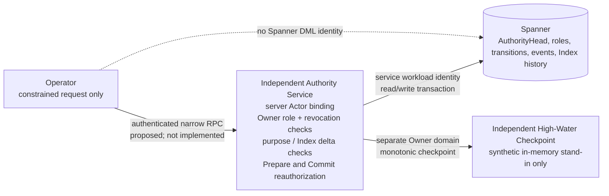

# RQ-03F-B3-D1A — Spanner-backed High-Water Authority Feasibility

**Disposition: `EMULATOR_PROTOCOL_PASS / PRODUCTION_TRUST_BLOCKED`.** This is a synthetic research prototype and feasibility report. It does not select Spanner as the production Authority, implement a production adapter, create cloud resources, or authorize protected writes.

## Baseline and scope

- Trusted starting master: `3f4cebf782f1cf4ab527efcf2b307fa461f0b9de`.
- Post-merge master CI [38150178775](https://github.com/ArdenZC/codex-work-skills/actions/runs/38150178775): `SUCCESS`, exact starting master SHA, 30/30 jobs successful.
- Formal Trust Anchor: `eb4a95c618e05c5ad6413137478bc65dbca75ec9` (read-only; unchanged).
- Existing formal Profile 1.0 SHA-256: `d8e2ac76552f76b5dacf1ab7e31014da68ffe757da9bff5c97d27be9b67effd4`.
- Existing formal Index 1.0 SHA-256: `52b3d01db27b10b4d9f54d6278a469ba7998a26057de93c8308b2b1fd50b67a4`.
- Golden corpus SHA-256: `96f5044f8b009d77c386e8acb414dface173bd5738354ae740d2361e0e52561a`.
- Blind holdout SHA-256: `268e95379a15e0c4a848332e8b3a33618d05cb889991730e23ff8e693a59b57a`.
- Original NC-02 SHA-256: `878604a6afba0b50dd758290ac280386fc301a9c76ff263cbece667ac8447352`.
- All 17 frozen Content byte sequences were independently rechecked against the frozen fixture manifest; all match. No frozen corpus, Golden/Blind data, Original NC-02, Profile, Index, Trust Anchor, or production business schema was changed.
- No GCP project, Spanner instance, production credential, paid resource, production Authority, formal Intake, Agent A/B, or live qualification was used or created.

The starting review covered Issue #64; the D0 acceptance matrix, Owner decision register, production Authority options, deployment readiness and pin-migration reports; C1/C2/C3 implementations; and the latest master. D0 still records architecture choice, independent administration, Authority Genesis, role registry, Profile/Index 1.1 adoption, and production deployment as Owner decisions or open prerequisites.

## Existing production boundary

C3 defines the `HighWaterAuthority` protocol and `MonotonicTransitionCoordinator`; it does not ship a production database adapter. C2's `require_protected_write()` remains unconditional: absent an accepted C3 anti-rollback Gate it raises `C3_ANTI_ROLLBACK_GATE_REQUIRED`. This research work did not change either boundary, their schemas, or the formal trust material.

The purpose mapping used by the prototype is copied from the closed C3 contract, not inferred from enum names:

| Operation purpose | Exact Index delta | Role / authorization class | State rule |
| --- | --- | --- | --- |
| `qualification_corpus_intake` | Exactly one `qualification_corpus_intakes[]` row | `qualification_corpus_custodian` / `operator_role_operation` | Same epoch |
| `production_authoring` | Exactly one `authors[]` row | `author` / `operator_role_operation` | Same epoch |
| `epoch_transition` | No business Index rows | `owner_policy_transition` / `owner_policy_transition` | One epoch advance under the C3 contract |
| `revocation` | No business Index rows | `owner_policy_transition` / `owner_policy_transition` | One epoch advance with monotonic revocation state |
| Any other purpose | No mutation permitted | None | Fail closed |

Existing Index 1.1 validation binds purpose, row count/type, operation ID, and the authorized Actor. The prototype calls that validator; it does not widen its scope or alter the business schema.

## Proposed three-layer architecture

The prototype exercises the request/service/storage separation. Only the Authority Service holds a Spanner database handle. The authentication and Owner registry shown below are synthetic in the prototype; a real deployment would need independent Owner-controlled providers and identities.

Required production ownership: Operators receive neither Spanner database access nor a service credential that can be used to write Authority tables. An independently administered service authenticates the caller, derives Actor identity from the authenticated channel, reads current Owner authorization/revocation state, and performs the constrained transaction using its own workload identity. The Owner role/authorization administration, service deployment and recovery controls, and external high-water checkpoint must be administered outside the Operator/Candidate domain. None of those real identities or independent administrative domains were provisioned here.

### Threat model and trust boundary

The research threat model treats Operator request JSON, supplied Actor/role/fence/time values, old Index bytes, transition IDs, stale sequence/hash, and mixed-purpose appends as untrusted. The service rejects caller-supplied Actor, role, fencing token, timestamps, and extra fields; derives the synthetic Actor from a test authenticator; checks the Owner Role Registry row and current time/epoch/revocation; validates exact Index 1.1 bytes through C3; and rechecks authorization in the Commit transaction.

The prototype does **not** defend against compromise of the Authority process, its Spanner identity, its role-registry administrator, its clock, Docker host, emulator, source branch, or external checkpoint administrator. The test authenticator is a local token map, not TLS, OIDC, IAM, workload identity, or a production principal proof. The synthetic `OwnerRoleRegistry` table resides in the same emulator database and is populated by a test-only provisioning helper. It is not an independent Owner registry and does not establish authorization.

## Synthetic database and transaction contract

Research DDL is in `research/rq03f_b3d1a_spanner/schema.sql`; all IDs use primary keys to enforce uniqueness at the database layer.

| Table | Purpose and binding |
| --- | --- |
| `AuthorityHead` | Single current sequence, complete C3 state, State digest, Policy epoch, Index revision/SHA/raw bytes, revocation SHA, fencing token and optional pending Transition ID. A read verifies stored state and Index bytes against their SHA values and C3 state bindings. |
| `OwnerRoleRegistry` | Synthetic-only grant keyed by authorization reference; binds principal, role, authorization class, purpose, epoch, validity, revocation and a distinct approver. Production source/administration is unimplemented. |
| `TransitionRecords` | Unique Transition ID, exact request bytes/SHA, authenticated Actor, purpose, authorization reference/role/class/epoch/revocation binding, expected head, proposed state and Index SHA/revision, reservation expiry, fencing token, resolution and result. |
| `TransitionEvents` | Append-only per-transition `prepared`, `committed`, or `aborted` event, with canonical bytes and SHA. The parent key prevents orphan event rows. |
| `IndexHistory` | Immutable Index bytes/SHA by revision and originating Transition ID. |

**Prepare transaction:** Read the current Head and grant; reject an existing Transition ID, outstanding reservation, or stale expected sequence/head digest; validate the exact purpose-specific C3 proposal and authenticated Actor; insert a unique prepared record and `prepared` event; and reserve the next fencing token by setting the Head's pending Transition ID. The reservation expires no later than either the configured five-minute research TTL or the role grant expiry. The separate checkpoint is advanced after the Spanner transaction. Failure to confirm that checkpoint makes Prepare status unknown and blocks subsequent writes.

**Commit transaction:** In one Spanner read-write transaction, reload the prepared request, Head, and current grant; check the authenticated Actor, reservation expiry, pending Transition ID, fencing token, source sequence/digest, authorization validity/revocation/epoch/purpose, and exact saved request/Index/state bindings. On failure, write a durable `aborted` status/event and clear the reservation without changing committed Index bytes. On success, atomically update the Head, append `IndexHistory`, mark the Transition committed, and add the committed event. Only after that transaction returns does the prototype advance the separate checkpoint. If the checkpoint cannot confirm, the call returns `COMMIT_STATUS_UNKNOWN`; the database being ahead of the checkpoint causes `RECOVERY_REQUIRED`, and no automatic retry or checkpoint adoption occurs.

Spanner transaction callbacks contain database operations only: no external checkpoint, network or filesystem side effect is executed inside a callback that the SDK may retry. The prototype's current two-step DB/checkpoint update deliberately fails closed on partial completion. It does not solve independent checkpoint deployment, durable reconciliation, or atomicity across the two trust domains.

## Prototype and dependency isolation

New research-only files:

- `research/rq03f_b3d1a_spanner/authority_service.py` — synthetic service and constrained Operator client, explicit local-emulator endpoint guard, C3 validation calls, synthetic checkpoint, and one-shot fault hooks.
- `research/rq03f_b3d1a_spanner/schema.sql` — isolated research schema; no production schema changes.
- `research/rq03f_b3d1a_spanner/tests/test_authority_service.py` — 25 Emulator-backed contract and negative tests.
- `research/rq03f_b3d1a_spanner/run_emulator_tests.sh` — loopback-only Docker launcher pinned to the official Emulator image digest.
- `research/rq03f_b3d1a_spanner/requirements-spanner.txt` and `requirements-spanner-lock.txt` — research-only dependency declaration and complete pinned transitive lock.
- `.github/workflows/rq03f-b3d1a-spanner-emulator.yml` — isolated Ubuntu research check, read-only repository permission, no GCP secrets, and no required-gate replacement.

Research dependency set: `google-cloud-spanner==3.71.0`, `jsonschema==4.26.0` plus the exact transitive pins in `requirements-spanner-lock.txt`. Local verification used Python `3.12.14`. The Ubuntu workflow installs only this research lock and runs the pinned image `gcr.io/cloud-spanner-emulator/emulator@sha256:c6f3402f2599684f295a0fdefb6fbbbfb18a0e43e309ff5456ccb452a4570a79`. The adapter refuses any `SPANNER_EMULATOR_HOST` except loopback port 9010. These dependencies are not added to the shipped Controller runtime closure or package.

The workflow and harness are branch-controlled by the candidate commit. The workflow has no production credential and read-only repository permission, but the branch controls its test code; therefore CI is repeatable research evidence, not an independently trusted security proof.

## Emulator results and fault matrix

Local command: `RQ03F_SPANNER_PYTHON=/tmp/rq03f-b3d1a-venv/bin/python bash research/rq03f_b3d1a_spanner/run_emulator_tests.sh` — **25 tests passed** against the pinned official Emulator image. The workflow repeats this command after installing the research lock. Final exact-HEAD hosted run is listed below.

| Scenario | Result checked in final state | Evidence limit |
| --- | --- | --- |
| Atomic `Prepared → Committed` | Head sequence, exact Index SHA/bytes, transition status and two event records agree after commit. | Emulator transaction behavior only. |
| `Prepared → Aborted` | Abort status/event is durable; pending reservation clears; sequence and Index bytes remain unchanged. | No production recovery service. |
| Known failure versus lost/unknown ACK | A one-shot injected pre-transaction rejection leaves status prepared and does not mutate Head/Index; a subsequent explicit same-ID Commit succeeds. A post-commit lost ACK is resolved by reading that exact Transition ID as committed. | The known-abort hook is an injected pre-send failure, not a real Spanner `ABORTED` response. No retry behavior claim for production SDK/network failures. |
| Authorization expires or is revoked after Prepare | Commit rechecks the grant, durably aborts, and leaves Index bytes/head sequence unchanged. | Test clock and synthetic grants only. |
| Two concurrent writers against one head | Exactly one prepared transition is accepted; the other receives busy/stale; one commit advances the final head. | Emulator's locking/serialization is not a production contention benchmark. |
| Duplicate Transition ID | Second Prepare/Commit rejected; one committed record and exactly one prepared+committed event pair remain. | Emulator only. |
| Old epoch or Index revision | Prepare is rejected; no new Transition record, no head change. | C3 contract validation plus Emulator. |
| Purpose/delta mismatch and mixed purpose | Intake cannot add Author, Receipt, or Qualification Run; Intake+Author in one transaction rejected; no transition/head/index mutation. | Existing closed C3 mapping only. |
| Actor / role / authorization mismatch | Supplied Actor fields are rejected; row Actor must equal authenticated synthetic peer; wrong role/class/reference rejected without state mutation. | Synthetic token authenticator is not real identity. |
| Legal exact scopes | One purpose-authorized Intake and one purpose-authorized production Author append commit with exact binding. Epoch and revocation examples use their separate Owner-only scopes and no business rows. | Does not activate Production Trust or authorize a formal business write. |
| Unknown Commit with checkpoint unavailable | Database commit exists but checkpoint cannot be confirmed; status is temporarily unavailable; after checkpoint access returns, transition status is committed while current state remains `RECOVERY_REQUIRED` because the external checkpoint is stale. No retry or implicit checkpoint advance occurs. | In-memory checkpoint is not durable/independent; this demonstrates fail-closed handling only. |
| Old database snapshot | Test-only Head restoration to an earlier sequence is rejected against the later external checkpoint as `ROLLBACK_DETECTED`. | Not a real backup/restore or durable cross-restart exercise. |
| Checkpoint unavailable before Prepare | Request is rejected; Head/Index and Transition table remain unchanged. | Synthetic availability fault only. |
| Operator direct storage bypass | Operator-shaped RPC object has no DB handle. A separately constructed Spanner client can nevertheless update Head directly in Emulator; the Authority detects DB-ahead-of-checkpoint and blocks as `RECOVERY_REQUIRED`. | **Not a security PASS.** Emulator has no IAM; direct DML succeeds. Production requires independently verified IAM that denies Operator database access. |
| Non-emulator endpoint | Adapter construction/initialization is rejected unless the endpoint is loopback Emulator. | Prevents accidental use of real endpoints from this research module; does not establish real service security. |

## Exact-HEAD CI

The new workflow is needed because existing repository gates do not provision the official Spanner Emulator or install its isolated research SDK lock. It adds one non-required research job and preserves all existing workflows, gates, and matrix coverage.

- Master post-merge run [38150178775](https://github.com/ArdenZC/codex-work-skills/actions/runs/38150178775) — `SUCCESS` on exact baseline master `3f4cebf782f1cf4ab527efcf2b307fa461f0b9de` (pre-change baseline evidence).
- Implementation commit `598bced0d65189fc7ca4b4d77474223cda0cecc5`, Tree `1e4b72aed4af4d1cddf683120503d80bc6ddf710`:
  - [Spanner Emulator research workflow 38154778449](https://github.com/ArdenZC/codex-work-skills/actions/runs/38154778449) — `SUCCESS`; exact commit checkout, isolated dependency install and Emulator test step passed.
  - [Template Package CI 38154778111](https://github.com/ArdenZC/codex-work-skills/actions/runs/38154778111) — `SUCCESS`, 40 jobs successful and one conditional job skipped. Windows/macOS Semantic Scope was 12/12; Windows/macOS Gradebook both passed. No failed jobs.

The report-only evidence refresh is intentionally separate from the implementation commit. It does not change source, tests, schema, workflow, or dependencies; GitHub runs both checks again on the new exact PR head. The final PR head and its latest exact-head workflow run links are delivered with the review result. Check [PR #65 checks](https://github.com/ArdenZC/codex-work-skills/pull/65/checks) for those final-head runs. No CI result is attributed to a SHA other than the SHA GitHub reports for that run.

## Emulator limitations and unverified production claims

Google's [Spanner Emulator documentation](https://docs.cloud.google.com/spanner/docs/emulator) explicitly limits the Emulator to local testing. It is in-memory and loses all state when restarted; it does not provide TLS/HTTPS, authentication, IAM, database roles/permissions, audit logging or monitoring. Its read-write transaction locking and performance/scalability differ from the managed service. Therefore the following remain **`UNVERIFIED`**:

1. Real TLS, peer identity, service authentication, credential rotation, and revocation.
2. GCP IAM separation between Operator, Authority Service, database administrators, Owner registry administrators, and backup/restore administrators; direct Operator DML denial.
3. Production Spanner transaction contention, retry/abort and network failure behavior, quotas, service guarantees, and cross-region behavior.
4. Persistence and exact Authority behavior across service, database, project, and region restarts.
5. Independent Owner administrative domain and control of the service image, workload identity, role source, recovery process, and logs.
6. Backup/restore high-water integrity and safe staging/reattachment. [Spanner backup docs](https://docs.cloud.google.com/spanner/docs/backup) note that backup restore and IAM need deliberate handling; restored state must be quarantined and checked against an independently retained checkpoint.
7. Independent checkpoint durability, authentication, quorum/availability, backup/recovery, and the non-atomic boundary between a Spanner commit and checkpoint advance.
8. Actual cost, latency, availability, regional topology, and capacity. No region, instance configuration, storage estimate, request rate, retention, or service-level target was selected, so no numeric cost estimate is defensible. Owner must model compute/processing, storage, network, backup retention, logging, quotas and support using the selected configuration and [current pricing](https://cloud.google.com/spanner/pricing).

The cloud transaction documentation describes serializable read-write transactions and retryable callbacks; the production adapter must keep callback side effects inside Spanner and treat an ambiguous commit as unknown until read-after-status resolution by Transition ID. See [Spanner transactions](https://docs.cloud.google.com/spanner/docs/transactions) and the [Commit API outcome documentation](https://docs.cloud.google.com/spanner/docs/reference/rest/v1/projects.instances.databases.sessions/commit). This prototype only injects a post-commit lost ACK and a pre-transaction known failure; it does not inject a real network partition or managed Spanner `UNKNOWN` outcome.

## Spanner versus etcd remaining gap

Both are plausible transaction primitives, not complete Authorities. Spanner offers managed serializable/external-consistency transactions and lower self-hosting burden, but creates cloud IAM, service identity, account governance, provider dependency, cost, quota, backup/restore and external-checkpoint integration work. The Emulator cannot validate any of those managed-service controls.

An independently operated etcd deployment offers Raft-backed compare-and-update and linearizable default reads, but requires the Owner to operate quorum membership, upgrades, availability, monitoring, certificates, backup custody and incident recovery. etcd snapshot restore has its own revision recovery mechanism, but a bumped store revision alone does not prove application-level Authority state is latest; an independent Owner checkpoint remains necessary. References: [etcd API guarantees](https://etcd.io/docs/v3.5/learning/api_guarantees/) and [etcd disaster recovery](https://etcd.io/docs/v3.7/op-guide/recovery/).

This work did not run a real Spanner instance or an etcd cluster, compare latency/cost, or determine an Owner's operational fit. The comparison remains a decision input, not a measured performance result.

## Production D1 decision

**Feasibility conclusion:** `CONDITIONAL — Spanner is a plausible transactional storage primitive for a separately administered Authority Service. The Emulator prototype verifies a narrow C3 transaction contract and useful fail-closed cases; it does not verify a production High-Water Authority.`

**Recommendation:** `NO-GO` to begin a production D1 adapter or enable production writes until the Owner resolves D0-01 architecture selection and supplies D0-02/D0-10 independent administration, real identity/role registry, Authority Genesis and checkpoint requirements. If the Owner selects Spanner, the next formal D1 scope should first require a separately owned non-production GCP project and prove IAM denial for Operators, service identity and role-revocation behavior, actual transaction contention/unknown outcomes, and quarantined backup restore against an independently retained high-water checkpoint. Numeric cost and availability targets must be Owner inputs. No emulator result should be adopted as formal Trust evidence.

Current state remains `PRODUCTION_TRUST_BLOCKED`; C2 protected writes remain denied. This report records no Owner decision, trust adoption, formal Authority Genesis, production authorization, merge, release, deployment, Intake, Agent A/B, live qualification, RC-02, or Lesson Skill 2.4 activation.
